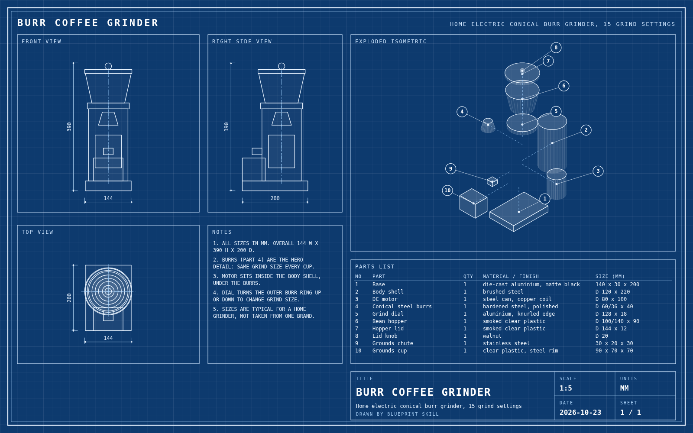

# Blueprint skill

**Draw the blueprint first, then let the AI build your 3D scene from it.**

Kimi K3.1 Pro can build 3D from "a text brief, sketch, or reference image". Give it a one-line brief and it guesses the shapes, the sizes and how the parts fit. Give it a blueprint and it builds to a plan.

Tell the skill what you want in 3D: a product, a machine, a room, a house, a scene. It:

1. **Aims higher:** names the goal beyond the goal and the one hero detail an expert would look for.
2. **Designs it like an industrial designer:** every part with real sizes, materials and how it comes apart.
3. **Draws a real blueprint:** front, side and top views, an exploded view, a parts list and a title block, on blueprint blue, with a Download PNG button.
4. **Writes the build prompt:** an expert brief with the blueprint inside, ending with a check where the model renders its build from the front, side and top and compares it with the blueprint.



Open [the full example](skills/blueprint/examples/coffee-grinder/blueprint.html) (download it and open it in your browser). A second example, [a vintage instant camera](skills/blueprint/examples/instant-camera/), was made by a fresh Claude Code agent with nothing but this skill.

## No install? Use the prompt

[PROMPT.md](PROMPT.md) is a copy-paste prompt that does the same rewrite in any AI chat, Kimi included. You get the blueprint as a table instead of a drawing.

## Install

**Claude Code**

```
/plugin marketplace add ydarwish1/blueprint-skill
/plugin install blueprint@amel-blueprint
```

or copy `skills/blueprint` into `~/.claude/skills/`.

**Kimi Code**

```
git clone https://github.com/ydarwish1/blueprint-skill.git
mkdir -p ~/.agents/skills
cp -r blueprint-skill/skills/blueprint ~/.agents/skills/
```

Then switch to Kimi K3.1 Pro with `/model` and type `/skill:blueprint` followed by your idea.

**Any other tool that supports Agent Skills:** copy `skills/blueprint` into its skills folder.

Needs Node.js 18 or newer to draw the blueprint (no packages to install).

## Use it

```
/blueprint a burr coffee grinder for a product page
/blueprint my kitchen: 4 x 3 m, island in the middle, window over the sink
/blueprint a vintage instant camera, exploded view
```

Then:
1. Open `blueprint.html` and press **Download PNG**.
2. In Kimi, pick **Kimi K3.1 Pro**, paste `build-prompt.md` and attach the PNG.
3. Open the page it builds. If a check fails, paste that line back and ask it to fix only that.

## What's inside

| Path | What it is |
|---|---|
| `skills/blueprint/SKILL.md` | the method |
| `skills/blueprint/scripts/render.mjs` | draws `blueprint.html` from `blueprint.json`, no dependencies |
| `skills/blueprint/references/spec.md` | the blueprint format |
| `skills/blueprint/references/build-prompt-template.md` | the expert build prompt |
| `skills/blueprint/examples/` | worked examples |
| `PROMPT.md` | the no-install prompt |

## Credits

The "aim higher" step follows Felix Rieseberg's ideas on ambition, as packaged in RoboNuggets' [be-ambitious](https://github.com/robonuggets/be-ambitious) skill. Made by Amel Solutions. MIT licence.
